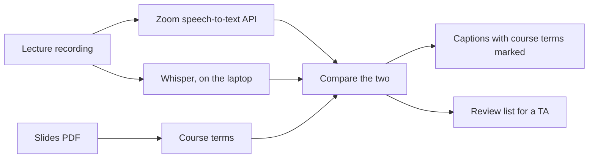

# CaptionFix

[](https://github.com/itsmeck24/captionfix/actions/workflows/ci.yml)

Every caption looks right. Some aren't. CaptionFix finds the course terms Zoom's lecture captions get wrong,
and sends a TA to them in six minutes of review per lecture hour.

**Project page: https://captionfix-chi.vercel.app**

[](https://captionfix-chi.vercel.app)

## Why

Many students read a lecture instead of hearing it: students who are deaf or hard of hearing, students
listening in a second language, anyone watching muted or rewatching at 2x.

Zoom's automatic captions get almost every word right. The ones they miss are the course terms, the words a
student searches for, writes down and gets tested on. On 13 hours of MIT lectures, Zoom got about
**1 in 7 course terms** wrong:

| The professor said | Zoom's captions said |
| --- | --- |
| branch **misprediction** | branch **risk prediction** |
| **unaligned** | **on aligned** |
| x **XOR** y | x, x **or** y |
| function **inlining** | function **inline** |

A wrong caption looks exactly as sure as a right one, and checking every word by hand takes as long as the
lecture itself.

## What it does

CaptionFix gets a second opinion on Zoom's captions and tells a person exactly where to look.

1. **Zoom writes the captions** through its speech-to-text API.
2. **A second model listens too.** Whisper transcribes the same recording on the laptop. Where the two
   disagree, something is probably wrong.
3. **Course terms come first.** Words from the lecture slides and other rare terms show which disagreements
   matter most, and those are marked in the captions.
4. **A TA reviews six minutes per lecture hour.** The most likely mistakes, 10% of the lecture, go on a review
   list. The TA plays each one, fixes or accepts it, and exports the captions the same day.

## Results

Recorded MIT OpenCourseWare lectures, scored against MIT's own human captions. Settings were chosen on 3
separate lectures before these were scored. Every number comes from a saved run in [`results/`](results).

| Lectures | Hours | Course terms said | Zoom got wrong | Found in the 6-minute review | Found by random checks |
| --- | --- | --- | --- | --- | --- |
| 9 lectures from 3 courses | 10.0 | 3,024 | 424 (1 in 7) | 37% | 12% |
| 4 lectures from a 4th course, added at the end | 3.4 | 547 | 98 (1 in 6) | 45% | 12% |

Six minutes of review per lecture hour finds three to four times as many course-term mistakes as checking
random stretches of the same length.

## How it works



- **Zoom pieces.** The recording is cut at quiet points into pieces of about four minutes and sent to Zoom's
  Scribe API. Each response is cached, so a crash or a rerun never pays for the same audio twice.
- **Second opinion.** Whisper large-v3-turbo runs locally through MLX, and the two transcripts are aligned
  word by word.
- **Course terms.** Rare, speakable words are pulled from the slides PDF; any word with a Zipf frequency
  under 3 also counts.
- **Review list.** Disagreements are ranked, course terms first, and grouped into stretches until 10% of the
  lecture is covered. The review page is a small FastAPI app.

## Run it

Needs a Mac with Apple silicon, Python 3.12, [uv](https://docs.astral.sh/uv/) and ffmpeg. The first run
downloads the Whisper model (1.6 GB).

```
uv sync
uv run captionfix run lecture.mp4 --slides slides.pdf --out out/lecture1
uv run captionfix review out/lecture1        # http://localhost:8000
```

The Zoom engine needs an API key from a Zoom AI Services account. Put it in `.env` as `ZOOM_API_KEY=...`.
Without a key, `--engine whisper` runs everything on the laptop.

Reproduce the numbers:

```
uv run python scripts/fetch_lectures.py
uv run python scripts/evaluate.py tune --engine zoom
uv run python scripts/evaluate.py test
uv run python scripts/evaluate.py fresh
```

## Tests

`uv run pytest -q`: 41 tests.

| Part | Real or mocked |
| --- | --- |
| Caption files (SRT, WebVTT, Zoom's VTT) | Real |
| Slide terms from PDFs | Real, on generated PDFs |
| Comparing transcripts, ranking the review list, scoring | Real, on small hand-written transcripts |
| Zoom, Whisper | Mocked in the pipeline tests |
| Crash and rerun without calling Zoom again | Real files, mocked engines |
| Review page | Real FastAPI app through its test client |

## Data and license

Lecture audio, slides and human captions are from [MIT OpenCourseWare](https://ocw.mit.edu) (6.0001 and 6.0002
Fall 2016, 6.172 Fall 2018, 6.S897 Spring 2019) under CC BY-NC-SA 4.0. They are downloaded by
`scripts/fetch_lectures.py` and not stored here; the project page uses a few short excerpts.

Code under the MIT license. Unofficial; not affiliated with Zoom, MIT or Arizona State University.
