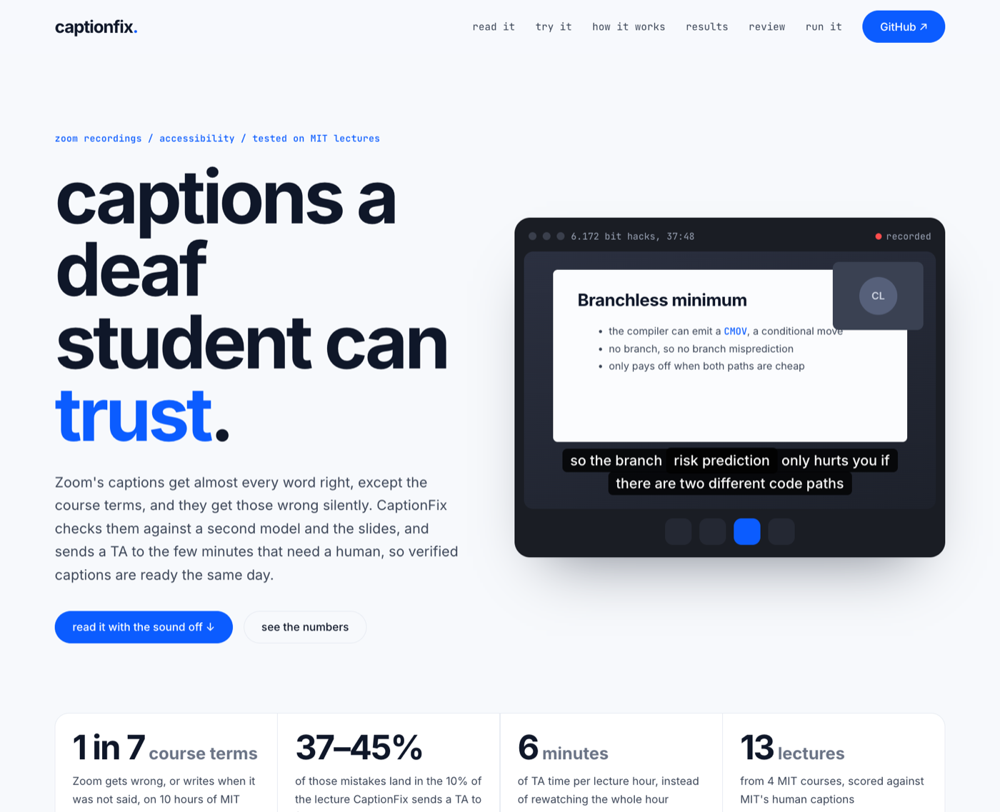
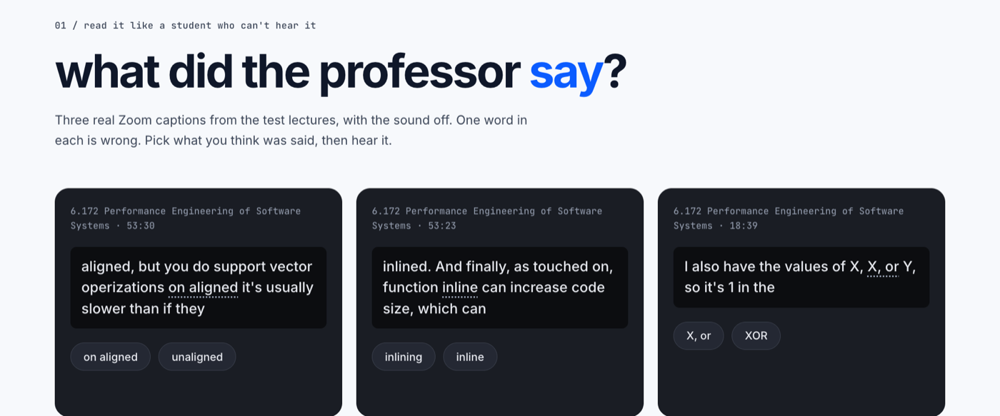
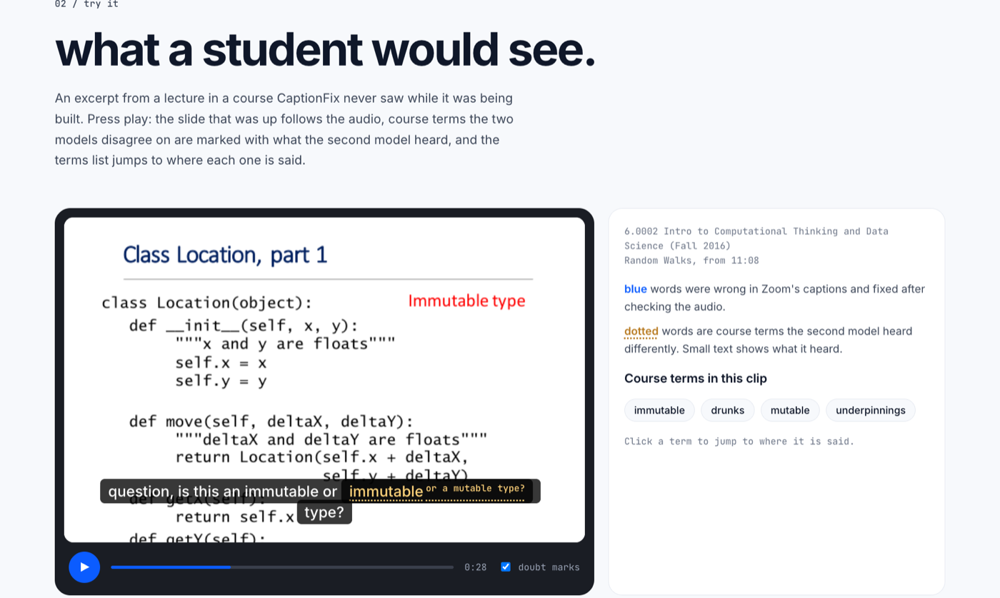
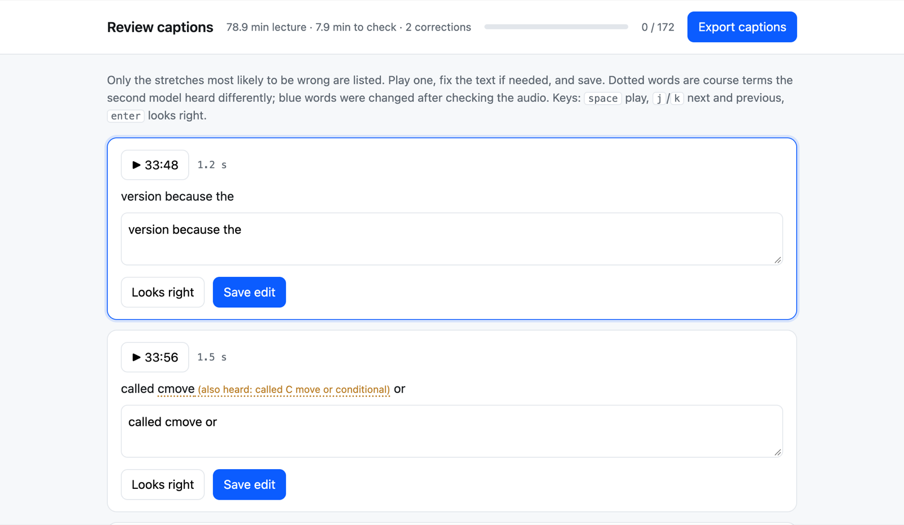
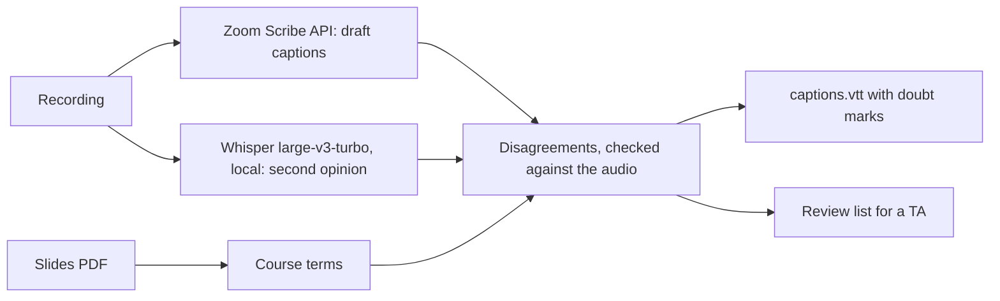

# CaptionFix

[](https://github.com/itsmeck24/captionfix/actions/workflows/ci.yml)

Lecture captions that a student who can't hear the lecture can trust.

[](docs/site.png)

## The problem

Many students read a lecture instead of hearing it: students who are deaf or hard of hearing, students
listening in a second language, anyone rewatching a recording. For them the captions are the lecture.

Zoom's automatic captions are good. On 13 hours of MIT lectures they got 95 to 97% of all words right. But they
got about **1 in 7 course terms** wrong, the exact words the class is about:

| The professor said | Zoom's captions said |
| --- | --- |
| branch **misprediction** | branch **risk prediction** |
| **unaligned** | **on aligned** |
| x **XOR** y | x, x **or** y |
| function **inlining** | function **inline** |

A wrong caption looks exactly as sure of itself as a right one. A student who can hear notices. A student who
can't copies the wrong word into their notes, searches for it, and studies it. Having a person check every
caption by hand fixes this, but it takes as long as the lecture, so verified captions usually arrive days later.

## What CaptionFix does

CaptionFix gets a second opinion on Zoom's captions and tells a person exactly where to look.

1. **Zoom writes the captions.** The recording goes to Zoom's speech-to-text service.
2. **A second model listens too.** An open-source model (Whisper) transcribes the same recording on the laptop.
   Where the two disagree, something is probably wrong.
3. **Course terms that are in doubt are marked**, using the lecture slides to know which words matter, so a
   student can see which words to double-check.
4. **A TA gets a short review list.** Instead of rewatching the whole lecture, the TA checks the 10% most likely
   to be wrong, about **6 minutes per lecture hour**, and exports corrected captions the same day.

**What it achieves:** those 6 minutes find **37 to 45% of the course-term mistakes**. Random spot checks of the
same length find 12%, so the list is three to four times better than looking at random. This held on lectures
from a course that was only added after everything was tuned.

**What did not work, and is turned off:** giving Zoom the slides as a vocabulary list, and letting the software
fix words by itself. Both were tested and made the captions worse overall. The numbers are below.

The project page lets you try it with the sound off: three real Zoom captions, one wrong word each.

[](docs/quiz.png)

And it shows what a student would see: the captions over the slide that was up, a course term marked with what
the second model heard (Zoom wrote "is this an immutable or immutable type?" where the professor said "immutable
or mutable"), and a list of the course terms that jumps to where each one is said.

[](docs/player.png)

The TA's review page lists only the flagged stretches. Play one, fix it or press enter if it is right, export.

[](docs/review.png)

## For developers

- `captionfix run lecture.mp4 --slides slides.pdf` writes captions (`captions.vtt`), the review list and the
  course terms in doubt. Zoom recordings (.mp4 or .m4a) work as they are.
- Course terms are words from the slides plus rare words (Zipf frequency under 3).
- `captionfix review out/lecture1` opens the review page.
- `--engine whisper` runs everything locally, with no key and nothing sent anywhere.

## How it works



- **Zoom pieces.** The recording is cut at quiet points into pieces of about four minutes and sent as small
  MP3s in the request body. Each response is cached, so a crash or a rerun never pays for the same audio twice.
- **Second opinion.** Whisper transcribes the same audio locally. The two transcripts are aligned word by word.
- **Fixes only the audio backs.** When Whisper heard a course term that Zoom did not, both versions are scored
  against the audio with Whisper's decoder, and the change is kept only if it wins by a margin chosen on the
  tuning lectures.
- **Review list.** Words the two models disagree on are ranked, course-term disagreements first, and grouped into
  stretches until the review budget is used.
- **Slide vocabulary, tried and turned off.** Zoom accepts up to 100 vocabulary phrases. Both the whole deck and
  only the terms of the slides being talked about (matched from the transcript, `captionfix/sync.py`) made Zoom
  write course terms that were never said. Results below.

## Results

Every number comes from a saved run in [`results/`](results), scored against MIT OpenCourseWare's human captions
after Whisper's English text normalizer. Settings were chosen on 3 tuning lectures by rules written in
[`scripts/evaluate.py`](scripts/evaluate.py) before the test lectures were scored. A course-term mistake is a
course term in MIT's captions that the transcript got wrong, or a course term the transcript wrote that MIT's
captions do not have.

**Test: 9 lectures, 10.0 hours, three courses** (6.0001 Python, 6.172 performance engineering, 6.S897 machine
learning for healthcare).

| | Word error rate | Course-term mistakes (of 3,024 terms said) |
| --- | --- | --- |
| Zoom Scribe | 4.68% | 424 |
| Zoom Scribe, every slide term as vocabulary | 4.77% | 534 |
| Whisper large-v3-turbo | 5.58% | 582 |
| Whisper, prompted with slide terms | 5.40% | 596 |
| CaptionFix on Whisper (all local) | 5.50% | 566 |
| CaptionFix on Zoom | 4.69% | 434 |

Automatic fixes on top of Zoom fixed 2 words and broke 7. Whisper is the weaker model, so when the two disagree
it is usually Whisper that is wrong. On Whisper as the draft, the fixes help (25 fixed, 17 broken).

**Fresh: 4 lectures, 3.4 hours, from a course that was only downloaded after every setting was fixed** (6.0002
computational thinking and data science, different lecturers).

| | Word error rate | Course-term mistakes (of 547 terms said) |
| --- | --- | --- |
| Zoom Scribe | 2.52% | 98 |
| Zoom Scribe, every slide term as vocabulary | 2.51% | 89 |
| Whisper large-v3-turbo | 3.31% | 129 |
| CaptionFix on Zoom | 2.51% | 97 |

Here the slide vocabulary helped a little (89 against 98); on the test lectures it hurt (534 against 424).

**The review list.** Share of the remaining course-term mistakes (and of all mistakes) inside the flagged
stretches:

| Review time | Course-term disagreements first | Any disagreement | Logistic model | Random stretches |
| --- | --- | --- | --- | --- |
| 5% of the lecture (3 min per hour) | 26% (23%) | 21% (23%) | 21% (22%) | 7% (7%) |
| 10% (6 min per hour) | 37% (42%) | 38% (42%) | 39% (41%) | 12% (12%) |
| 20% (12 min per hour) | 58% (63%) | 58% (63%) | 60% (63%) | 25% (24%) |
| 10%, fresh course | 45% (42%) | 45% (42%) | 46% (42%) | 12% (12%) |

Six minutes per lecture hour finds three to four times as many course-term mistakes as spot checks of the same
length, on the test lectures and on the fresh course. Disagreement is nearly the whole signal; ranking course
terms first only helps at the smallest budget.

**Slide vocabulary for Zoom, tuning lectures** (3 lectures, 3.6 hours):

| What Zoom was given | All errors | Course-term mistakes |
| --- | --- | --- |
| Nothing | 1,263 | 109 |
| Terms of the 2 slides being talked about | 1,283 | 115 |
| Terms of the 4 slides being talked about | 1,296 | 122 |
| Every slide term (up to 100) | 1,302 | 128 |

**Doubt marks.** On the test lectures, 165 course terms were marked; 30% of them were real mistakes, and they
covered 12% of the course-term mistakes (fresh course: 37 marks, 35%, 15%). Most false alarms are Whisper
splitting a term Zoom got right ("x or" for "XOR"). The marks are a hint for the reader, not a verdict.

**A note on the answer key.** MIT's captions are cleaned up (no "um", fewer repeats), which counts against every
system equally, and they have their own slips: "remeber", "raytio", and a few course terms where Zoom looks
right.

## Run it

Needs a Mac with Apple silicon, Python 3.12, [uv](https://docs.astral.sh/uv/) and ffmpeg. The first run
downloads the Whisper model (1.6 GB).

```
uv sync
uv run captionfix run lecture.mp4 --slides slides.pdf --out out/lecture1
uv run captionfix review out/lecture1        # http://localhost:8000
```

The Zoom engine needs an API key from a Zoom AI Services account (zoom.ai, API keys). Put it in `.env`:

```
ZOOM_API_KEY=...
```

Scribe is billed per second of audio. Everything above used about 9 of the 20 free trial credits. With
`--engine whisper` no key is needed.

Reproduce the numbers (downloads 16 lectures, about 2 GB of audio):

```
uv run python scripts/fetch_lectures.py
uv run python scripts/evaluate.py tune --engine zoom
uv run python scripts/evaluate.py tune --engine whisper
uv run python scripts/evaluate.py test
uv run python scripts/evaluate.py fresh
uv run python scripts/evaluate.py doubts
```

Zoom responses and transcripts are cached in `runs/`, so a rerun only redoes the scoring.

## Tests

`uv run pytest -q`: 41 tests.

| Part | Real or mocked |
| --- | --- |
| Caption parsing and writing (SRT, WebVTT, Zoom's VTT) | Real |
| Slide terms from PDFs | Real, on generated PDFs |
| Slide matching for vocabulary | Real |
| Fixes, review ranking, scoring | Real, on small hand-written transcripts |
| Zoom Scribe, Whisper, audio scoring | Mocked in the pipeline tests |
| Crash and rerun without paying Zoom again | Real files, mocked engines |
| Review server | Real FastAPI app through its test client |

## Data and licenses

Lecture audio, slides and human captions are from [MIT OpenCourseWare](https://ocw.mit.edu) (6.0001 and 6.0002
Fall 2016, 6.172 Fall 2018, 6.S897 Spring 2019) under CC BY-NC-SA 4.0. They are downloaded by
`scripts/fetch_lectures.py` and not stored in this repository. The project page uses one short excerpt.

Code is under the MIT license. Unofficial; not affiliated with or endorsed by Zoom, MIT or Arizona State
University.
